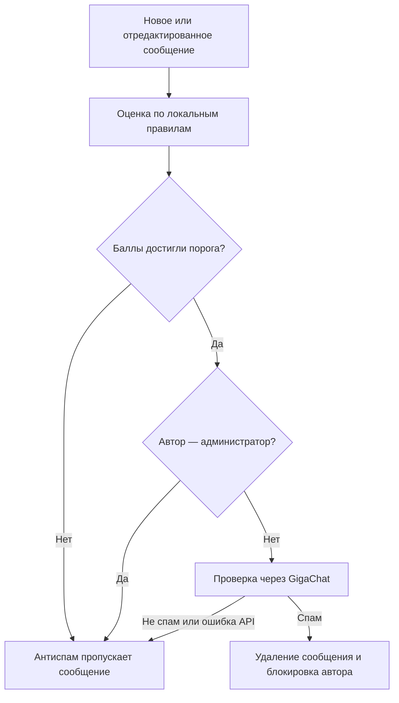

# Telegram Anti-Spam Bot

**Бот-модератор для Telegram-сообществ: проверяет участников, выявляет подозрительные сообщения и автоматически блокирует нарушителей.**

Проект помогает владельцам групп и чатов обсуждения при каналах автоматизировать часть повседневной модерации. Участник проходит простую проверку кнопкой, а при включённом AI-антиспаме подозрительный текст дополнительно анализирует GigaChat.

Базовая проверка работает без подключения нейросети. Механизмы защиты включаются отдельно через настройки.

## Содержание

- [Какую задачу решает](#какую-задачу-решает)
- [Возможности](#возможности)
- [Как это работает](#как-это-работает)
- [Технологии и архитектура](#технологии-и-архитектура)
- [Установка и запуск](#установка-и-запуск)
- [Настройки](#настройки)
- [Как продемонстрировать бота](#как-продемонстрировать-бота)
- [Особенности текущей версии](#особенности-текущей-версии)

## Какую задачу решает

В открытые Telegram-чаты приходят аккаунты с рекламой, сомнительными предложениями заработка и призывами перейти в личные сообщения. Администратору приходится вручную проверять участников, удалять сообщения и блокировать их авторов.

Бот берёт на себя типовые действия: запрашивает подтверждение у участника, следит за сроком проверки и применяет правила модерации. Это может быть полезно для сообществ, клиентских групп и чатов обсуждения, где нежелательны сторонняя реклама и коммерческие объявления.

С технической стороны проект демонстрирует работу с Telegram Bot API, асинхронной обработкой событий, базой данных и внешним AI-сервисом.

## Возможности

| Возможность | Что это даёт владельцу чата |
| --- | --- |
| Проверка при вступлении | Новый участник должен нажать кнопку «✅ Подтвердить» за отведённое время. |
| Проверка при первом сообщении | Бот запрашивает подтверждение у пользователя, который ещё не прошёл проверку в этом чате. |
| Временное ограничение сообщений | Пока идёт проверка, бот ограничивает возможность писать в чат. |
| Блокировка по тайм-ауту | Если участник не подтвердился, бот блокирует его и удаляет отслеживаемые сообщения. |
| Двухэтапный антиспам | Локальные правила находят подозрительный текст, затем GigaChat принимает решение о спаме. |
| Проверка после редактирования | AI-антиспам обрабатывает изменённые сообщения, в том числе текстовые подписи к медиа. |
| Сохранение статуса проверки | Успешное подтверждение сохраняется в SQLite отдельно для каждого чата. |
| Исключение администраторов | Владельцу и администраторам не нужно проходить проверку; AI-антиспам пропускает их сообщения. |
| Привязка к выбранному чату | Можно задать разрешённый чат: при добавлении в другой бот автоматически выйдет из него. |
| Журнал событий | В консоли видны проверки, сработавшие правила, решения GigaChat и действия бота. |

## Как это работает

### Проверка участника

1. Пользователь вступает в чат или отправляет сообщение, ещё не имея статуса подтверждённого участника.
2. Бот временно ограничивает отправку сообщений и показывает кнопку подтверждения.
3. Нажать кнопку может только тот пользователь, для которого она создана.
4. При подтверждении бот сохраняет статус в базе, восстанавливает права согласно настройкам чата и удаляет сообщение с кнопкой.
5. Если время истекло, бот удаляет сообщение проверки, отслеживаемые сообщения пользователя и отправляет запрос на его блокировку.

По умолчанию на подтверждение даётся **30 секунд**. Уже подтверждённый пользователь повторную проверку не проходит.

### Поиск спама

При включённом AI-антиспаме текст проходит два этапа:



Локальные правила начисляют баллы за ссылки, контакты, упоминания денег, вакансий, сомнительных предложений и другие признаки. По умолчанию запрос в GigaChat отправляется при **4 баллах и выше**. Сообщения ниже порога не требуют обращения к AI-сервису.

Например, текст «Подработка, оплата ежедневно, пиши в личку» набирает баллы за предложение работы, упоминание оплаты и призыв написать лично. Он передаётся модели, а блокировка происходит только при ответе `spam`.

Если GigaChat недоступен, ключ не задан или ответ не удалось обработать, AI-антиспам пропускает сообщение и записывает причину в журнал. Проверка участника кнопкой остаётся отдельным механизмом. Успешное нажатие кнопки не освобождает пользователя от последующего анализа сообщений.

## Технологии и архитектура

| Технология | Роль в проекте |
| --- | --- |
| Python, asyncio | Асинхронная обработка событий и таймеров проверки. |
| aiogram 3 | События Telegram, команды, кнопки и действия модератора. |
| SQLAlchemy 2 + aiosqlite | Асинхронный доступ к SQLite и хранение статуса участников. |
| GigaChat API | Классификация подозрительного текста с краткой причиной решения. |
| python-dotenv | Загрузка конфигурации из `.env`. |
| logging | Журналирование событий, ошибок и результатов модерации. |

Версии зависимостей зафиксированы в [requirements.txt](requirements.txt).

```text
bot/
├── main.py                      # Инициализация и запуск polling
├── config.py                    # Настройки из переменных окружения
├── logging_utils.py             # Форматирование данных для журнала
├── handlers/                    # Обработчики событий Telegram
│   ├── start.py                 # Команды /start и /help
│   ├── access.py                # Проверка разрешённого чата
│   ├── verification.py          # Вступление в чат и нажатие кнопки
│   └── moderation.py            # Новые и отредактированные сообщения
├── services/                    # Логика проверки и модерации
│   ├── verification.py          # Ограничения, таймеры и подтверждение
│   ├── spam_scoring.py          # Локальная оценка признаков спама
│   ├── spam_moderation.py       # Действия с сообщением и автором
│   └── gigachat_moderation.py   # Авторизация и запросы к GigaChat
├── database/                    # Модель пользователя, сессии и запросы
├── keyboards/                   # Кнопка подтверждения
└── middlewares/                 # Журналирование входящих сообщений
```

Обработчики Telegram отделены от логики модерации и доступа к данным. Проверки участников используют отдельные асинхронные задачи и блокировки по паре «чат — пользователь». Интеграция GigaChat кеширует токен доступа, обновляет его при истечении срока и повторяет запрос после ошибки авторизации `401`.

Бот получает события через **long polling** — сам обращается к Telegram за обновлениями. Публичный HTTP-сервер для запуска не требуется.

## Установка и запуск

### 1. Подготовить окружение

Нужны Python 3.10 или новее, доступ к интернету, токен Telegram-бота и тестовая супергруппа. Для AI-антиспама дополнительно нужен ключ авторизации GigaChat API.

Выполните команды из корня скачанного или клонированного проекта:

```bash
python -m venv .venv
```

Активируйте окружение в macOS / Linux:

```bash
source .venv/bin/activate
```

Или в Windows PowerShell:

```powershell
.venv\Scripts\Activate.ps1
```

Установите зависимости:

```bash
python -m pip install -r requirements.txt
```

### 2. Настроить бота

Создайте бота через **@BotFather** в Telegram и получите токен. Скопируйте [.env.example](.env.example) в `.env`, затем замените значения-заглушки:

```dotenv
TG_BOT_TOKEN=your_telegram_bot_token
ALLOWED_CHAT_ID=-1001234567890
VERIFICATION_TIMEOUT_SECONDS=30
JOIN_VERIFICATION_ENABLED=1
FIRST_MESSAGE_VERIFICATION_ENABLED=1
GIGACHAT_SPAM_MODERATION_ENABLED=0
```

`ALLOWED_CHAT_ID` должен содержать числовой ID вашей группы. Если привязка к одному чату не нужна, **удалите эту строку**: пустое значение не подходит, поскольку код ожидает целое число.

Добавьте бота в супергруппу и назначьте администратором с правами удалять сообщения, ограничивать и блокировать участников. Бот также должен иметь возможность отправлять сообщения с кнопкой проверки.

### 3. Запустить

```bash
python -m bot.main
```

При первом запуске автоматически создаются файл `bot.db` и таблица пользователей. Журнал событий выводится в консоль. Для постоянной работы процесс бота должен оставаться запущенным на компьютере или сервере.

| Команда в Telegram | Действие |
| --- | --- |
| `/start` | Приветствие бота. |
| `/help` | Краткое описание его назначения. |

### 4. При необходимости подключить GigaChat

Укажите в `.env` ключ авторизации и включите анализ:

```dotenv
GIGACHAT_SPAM_MODERATION_ENABLED=1
GIGACHAT_AUTH_KEY=your_gigachat_authorization_key
```

Модель и область доступа должны соответствовать вашему доступу к API. После изменения `.env` перезапустите бота.

## Настройки

| Переменная | По умолчанию | Назначение |
| --- | --- | --- |
| `TG_BOT_TOKEN` | Не задан | Обязательный токен Telegram-бота. |
| `ALLOWED_CHAT_ID` | Не задан | Разрешённый чат. При отсутствии переменной привязка отключена. |
| `VERIFICATION_TIMEOUT_SECONDS` | `30` | Время на нажатие кнопки, в секундах. |
| `JOIN_VERIFICATION_ENABLED` | `1` | Проверка при вступлении. |
| `FIRST_MESSAGE_VERIFICATION_ENABLED` | `1` | Проверка при сообщении от неподтверждённого участника. |
| `GIGACHAT_SPAM_MODERATION_ENABLED` | `0` | Включение всей цепочки «локальные правила → GigaChat». |
| `GIGACHAT_AUTH_KEY` | Не задан | Ключ авторизации для AI-антиспама. |
| `GIGACHAT_MODEL` | `GigaChat-2` | Имя модели в запросах к API. |
| `GIGACHAT_SCOPE` | `GIGACHAT_API_PERS` | Область доступа при получении токена. |
| `SPAM_SCORE_THRESHOLD` | `4` | Минимальный балл для обращения к GigaChat. |
| `GIGACHAT_REQUEST_TIMEOUT_SECONDS` | `20` | Тайм-аут отдельного HTTP-запроса к GigaChat, в секундах. |
| `GIGACHAT_VERIFY_SSL` | `1` | Проверка TLS-сертификата при запросах к GigaChat. |

Для переключателей используйте `1` — включить, `0` — выключить. Проверку TLS-сертификата следует оставлять включённой.

### Режимы обработки сообщений

| Проверка при первом сообщении | AI-антиспам | Поведение |
| --- | --- | --- |
| `1` | `0` | Только подтверждение участника кнопкой. |
| `0` | `1` | Только поиск спама через правила и GigaChat. |
| `1` | `1` | Сначала антиспам, затем проверка участника, если обработка не остановлена. |
| `0` | `0` | Оба механизма обработки сообщений отключены. |

Проверка **при вступлении** настраивается независимо через `JOIN_VERIFICATION_ENABLED`. Чтобы отключить все проверки, нужно выключить все три переключателя.

## Как продемонстрировать бота

Для показа используйте отдельную тестовую супергруппу и аккаунт участника без прав администратора.

1. **Успешная проверка.** Добавьте нового участника: бот покажет кнопку и ограничит отправку сообщений. Нажмите кнопку — сообщение проверки исчезнет, права восстановятся.
2. **Истечение времени.** Повторите сценарий с другим, ещё не подтверждённым аккаунтом и не нажимайте кнопку. По истечении 30 секунд бот заблокирует участника.
3. **Проверка при первом сообщении.** Отключите проверку при вступлении, оставьте проверку первого сообщения и перезапустите бота. Отправьте сообщение от аккаунта без сохранённого подтверждения — появится кнопка.
4. **AI-антиспам.** Подключите GigaChat и отправьте подозрительный текст из примера выше. В журнале появятся баллы и ответ модели; при вердикте `spam` бот удалит сообщение и заблокирует автора.

Для последнего сценария решение зависит от ответа модели и доступности API. Результат анализа можно показать заказчику вместе с записью экрана тестового чата.

## Особенности текущей версии

- **Проверка кнопкой — простой барьер.** Она подтверждает действие пользователя, но не гарантирует, что аккаунт принадлежит человеку или не будет распространять спам.
- **Правила ориентированы на чаты без рекламы.** Текущая инструкция GigaChat строго оценивает вакансии, коммерческие предложения и призывы писать в личные сообщения. Для тематических чатов с объявлениями потребуется адаптация правил и инструкции модели; возможны ошибочные блокировки.
- **Анализируется текст и подписи к медиа.** Распознавание содержимого изображений, аудио и видео не реализовано. Сообщения от имени чата, автоматические пересылки и сообщения ботов пропускаются обработчиком модерации. Команды `/start` и `/help` обрабатываются отдельно.
- **Текущие проверки хранятся в памяти.** Подтверждённые статусы сохраняются в SQLite, но незавершённые проверки и их таймеры не восстанавливаются после перезапуска. Для участника, ограниченного до остановки, может понадобиться вмешательство администратора. Текущая схема рассчитана на один процесс бота.
- **Текст приглашения содержит фиксированные 30 секунд.** Настройка тайм-аута меняет реальное время ожидания; при её изменении нужно также обновить текст в обработчиках проверки.
- **Хранение и передача данных.** В `bot.db` находятся ID чатов, ID пользователей и статусы проверки. Журнал содержит сведения об участниках и фрагменты сообщений. При включённом AI-антиспаме подозрительный текст и контекст проверки передаются GigaChat. Не публикуйте `.env`, рабочую базу и журналы; файл `bot.db` пока не исключён в `.gitignore`.
- **Автоматические тесты и конфигурация развёртывания пока не добавлены.** В репозитории нет Docker-конфигурации, CI и готовой панели управления; настройки меняются через `.env` и код.

Лицензия в репозитории пока не указана.
